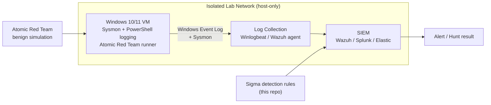

# ATT&CK Detection Lab

A hands-on detection-engineering lab that maps selected **MITRE ATT&CK** techniques to the
telemetry they generate and the detection logic that catches them. For each technique I run a
known-benign simulation, capture the resulting logs, and write a Sigma rule to detect it — the
same workflow a SOC detection engineer follows.

> **Purpose:** learn and demonstrate the *defensive* side of adversary techniques — what they look
> like in logs and how to detect them. There is **no offensive tooling in this repo.** Simulations
> are run with the published [Atomic Red Team](https://github.com/redcanaryco/atomic-red-team)
> project inside an isolated lab.

---

## Why this project

SOC and Attack Surface Management work is about *noticing* attacker behaviour in a flood of logs.
This repo documents that skill end to end for each technique:

1. **Understand** the technique and the tactic it serves.
2. **Simulate** it safely with a published, benign atomic test.
3. **Observe** the telemetry it produces (which log source, which event IDs, which fields).
4. **Detect** it with a Sigma rule that can be converted to Splunk, Elastic, or Wazuh.
5. **Validate** that the rule fires and reason about false positives.

---

## Lab architecture



The lab is fully offline (host-only networking). Nothing here touches a system you don't own.

---

## Detection coverage

| Technique | ID | Tactic | Primary telemetry | Detection |
|---|---|---|---|---|
| PowerShell | [T1059.001](https://attack.mitre.org/techniques/T1059/001/) | Execution | Script Block Logging (4104), Sysmon 1 | [Rule](techniques/T1059.001-powershell/detection.yml) |
| Scheduled Task | [T1053.005](https://attack.mitre.org/techniques/T1053/005/) | Execution / Persistence | Security 4698, TaskScheduler 106 | [Rule](techniques/T1053.005-scheduled-task/detection.yml) |
| Registry Run Keys | [T1547.001](https://attack.mitre.org/techniques/T1547/001/) | Persistence | Sysmon 13 (registry set) | [Rule](techniques/T1547.001-registry-run-keys/detection.yml) |
| Remote Desktop Protocol | [T1021.001](https://attack.mitre.org/techniques/T1021/001/) | Lateral Movement | Security 4624 (LogonType 10) | [Rule](techniques/T1021.001-rdp/detection.yml) |

Each technique folder has a full writeup. Start with
[T1059.001](techniques/T1059.001-powershell/README.md).

---

## Repository layout

```
attack-detection-lab/
├── docs/
│   └── lab-setup.md              # how to build the lab + enable logging
├── techniques/
│   ├── T1059.001-powershell/
│   ├── T1053.005-scheduled-task/
│   ├── T1547.001-registry-run-keys/
│   └── T1021.001-rdp/            # each has README.md + detection.yml
├── SECURITY.md
└── LICENSE
```

## Status / roadmap

- [x] Lab design and logging baseline
- [x] 4 techniques documented with Sigma rules
- [ ] Add captured log samples and screenshots from my own lab runs
- [ ] Convert Sigma rules to Wazuh rules and validate alerts
- [ ] Expand to credential-access and defense-evasion techniques

## Author

**Likhith H S** — M.Sc. Cyber Security, NFSU Goa · CEH · CCNA
[LinkedIn](https://www.linkedin.com/in/LikhithHS15) · [GitHub](https://github.com/Pzycokid)
